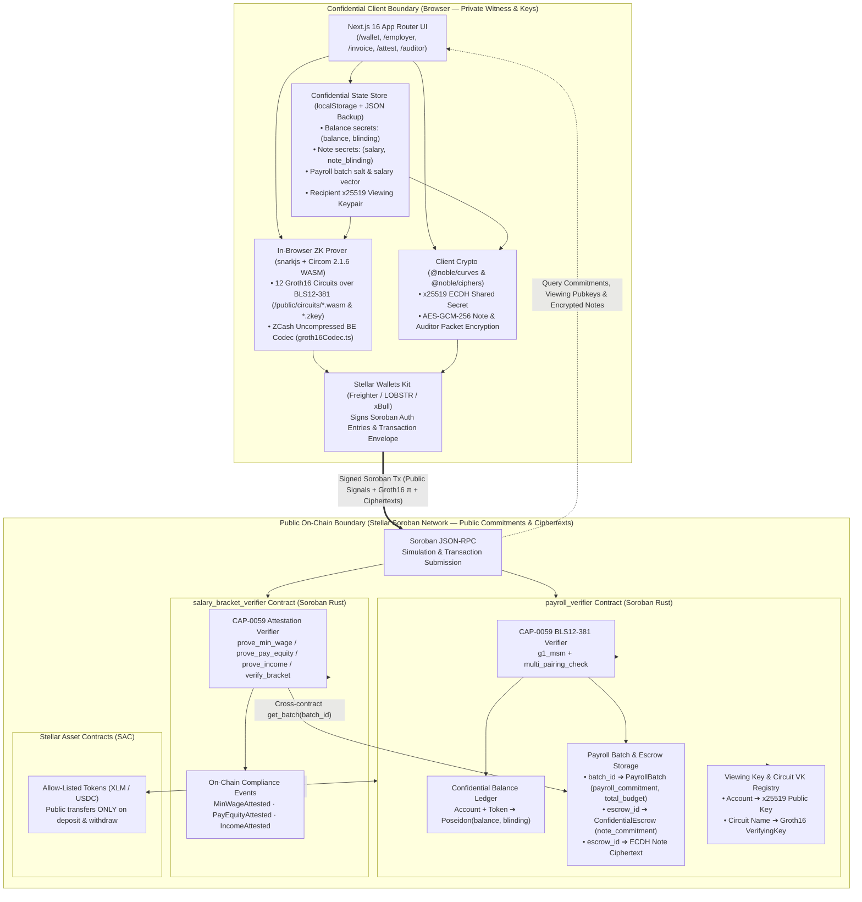
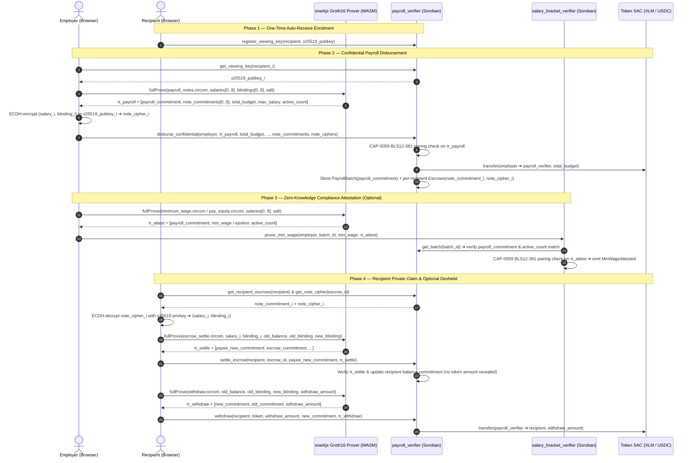

# LetsPay

**Confidential payroll on Stellar** — salaries, invoices, and income proofs where amounts are hidden on-chain, powered by Groth16 zero-knowledge proofs over BLS12-381, verified by Soroban smart contracts using CAP-0059 host functions.

---

## The problem

When you pay someone on Stellar, the amount is written to a public ledger forever. A standard token transfer cannot hide its value — the network has to see it to validate balances. So "private payroll" built on ordinary transfers isn't private at all; every salary is one block-explorer click away.

## The approach

Payfurt replaces transparent balances with a **confidential balance ledger**. Balances live on-chain only as Poseidon commitments — `Poseidon(balance, blinding)` — and every transition requires a Groth16 proof verified in the contract. The only points where an amount is unavoidable are the **deposit** (shield) and **withdraw** (deshield) boundaries where real tokens cross in or out.

This is **confidential-amount payments between identified parties** (Zcash/Zether-style), not an anonymity mixer. Senders and receivers are always visible; only the values are hidden. That distinction is deliberate — mixers pool unrelated funds to break the sender↔receiver link, which is the pattern that gets protocols sanctioned. Payfurt never does that.

---

## What it does

- **Confidential wallet** — shield tokens into a Poseidon commitment, top it up, withdraw. The balance is never an on-chain number.
- **Confidential payroll** — the employer pays only the (already-public) total in; each salary is locked as an opaque _note_ the recipient claims privately. The per-recipient split never touches the chain.
- **Auto-receive** — recipients enrol an x25519 viewing key once; the employer ECDH-encrypts each note to it and posts the ciphertext on-chain. Recipients log in and see pay waiting — one-click claim, no out-of-band sharing.
- **Compliance attestations** — prove minimum/living wage, pay equity, or cumulative income about salaries that stay secret, anchored to the on-chain payroll commitment. Proof passes → event emitted; nothing else written.
- **Confidential invoice escrow** — payer locks funds from a confidential balance into an opaque escrow; contractor proves the amount is within an agreed range and is credited confidentially.
- **Auditor view key** — employer encrypts the full salary list to an auditor's x25519 public key; the auditor decrypts and verifies against the on-chain commitment without any other party seeing the data.
- **Attestation trail** — auditable per-employer payment history; totals and headcounts only, no amounts.
- **Multi-token** — XLM, USDC, or any allow-listed Stellar asset.

Proofs are generated in the browser with snarkjs and verified on-chain by Soroban using Stellar's native BLS12-381 host functions (CAP-0059). The verifying keys live on-chain. If a proof fails, the contract returns an error and nothing is written.

---

## System Architecture

### 1. Component & Confidential Boundary Diagram

The diagram below shows how the browser client, client-side cryptographic modules, zero-knowledge circuits, Stellar wallets, Soroban smart contracts, and Stellar Asset Contracts (SAC) interact, and where the **confidential state boundary** lies:



### 2. End-to-End Employer, Recipient & Attestation Sequence



### 3. Public vs. Confidential Data Boundaries

| Data Element | On-Chain Visibility | How It Is Stored / Protected |
|---|---|---|
| **Individual Employee Salary (`salaries[i]`)** | **Confidential** (Never on-chain) | Hidden inside `note_commitment[i] = Poseidon(salary_i, blinding_i)` and encrypted via x25519 ECDH + AES-GCM-256 in `note_ciphers[i]`. |
| **Account Confidential Balance (`balance`)** | **Confidential** (Never on-chain) | Stored on-chain solely as `Poseidon(balance, blinding)` (`BytesN<32>`). Only the account holder knows `(balance, blinding)`. |
| **Invoice Escrow Amount (`escrow_amount`)** | **Confidential** (Never on-chain) | Hidden inside `escrow_commitment = Poseidon(escrow_amount, escrow_blinding)`. `escrow_settle` proves `escrow_amount ∈ [invoice_min, invoice_max]`. |
| **Employee Wage / Equity / Income Witness** | **Confidential** (Never on-chain) | Proven in zero knowledge against `payroll_commitment` or `note_commitments`; only boolean attestation events (`MinWageAttested`, `PayEquityAttested`, `IncomeAttested`) are emitted. |
| **Auditor Salary Breakdown Packet** | **Confidential to Auditor** | Encrypted client-side with the auditor's x25519 public key; verifiable against the on-chain `payroll_commitment`. |
| **Employer Total Payroll Budget (`total_budget`)** | **Public** | Visible on-chain when tokens are transferred into `payroll_verifier` during `disburse_confidential`. |
| **Shield (`deposit`) & Deshield (`withdraw`) Amounts** | **Public** | Visible at the token boundary where real SAC tokens (`XLM` / `USDC`) enter or leave the `payroll_verifier` contract. |
| **Sender & Recipient Stellar Addresses** | **Public** | Identified parties (`employer`, `recipient`, `payer`, `payee`) authenticate with `require_auth()`; LetsPay hides payment amounts, not participant identities. |

---

## How confidential payroll works

```
EMPLOYER (browser)                                    STELLAR (Soroban)
──────────────────                                    ─────────────────
salaries = [1, 2, 1.5] XLM     ← private witness
total    = 4.5 XLM              ← public by design
note_blinding[i]                ← random per-slot

payroll_commitment = Poseidon(sal[0..9], salt)
note_commitment[i] = Poseidon(sal[i], blinding[i])

Groth16 π proves:
  Σ active salaries == total_budget
  0 < sal[i] ≤ max_salary (∀ active i)
  each note opens to its salary            ──▶  BLS12-381 pairing check in contract
                                                ✓ employer pays `total` publicly
                                                  one opaque note stored per recipient

  ── auto-receive ──
  fetch recipient's registered viewing key
  ECDH-encrypt (salary, blinding) to it    ──▶  ciphertext stored alongside the note


RECIPIENT (browser, later)                            STELLAR (Soroban)
──────────────────────────                            ─────────────────
log in → scan escrows  ◀─────────────────────────   get_recipient_escrows / get_note_cipher
decrypt cipher with viewing key → (amount, blinding)
generate settle_escrow proof
claim  ──────────────────────────────────────────▶   credited to Poseidon(balance, blinding)
                                                      no amount on-chain

withdraw when ready  ────────────────────────────▶   real transfer (the only visible number)
```

The `1 / 2 / 1.5` split never appears on-chain. Only the `4.5` total and opaque commitments are visible. An individual amount surfaces only when that recipient chooses to withdraw.

---

## Circuits (10 total, all BLS12-381, Groth16)

| Circuit             | IC len | Public signals (output-first)                                                               | What it proves                                           |
| ------------------- | ------ | ------------------------------------------------------------------------------------------- | -------------------------------------------------------- |
| `deposit_new`       | 3      | `[commitment, amount]`                                                                      | `commitment = Poseidon(balance, blinding)`, `amount > 0` |
| `deposit_topup`     | 4      | `[new_commitment, old_commitment, amount]`                                                  | balance increases correctly                              |
| `withdraw`          | 4      | `[new_commitment, old_commitment, amount]`                                                  | balance decreases, stays ≥ 0                             |
| `escrow_lock`       | 4      | `[new_commitment, escrow_commitment, old_commitment]`                                       | payer debits correctly, escrow formed                    |
| `escrow_settle`     | 6      | `[payee_new_commitment, escrow_commitment, invoice_min, invoice_max, payee_old_commitment]` | amount in range, payee credited                          |
| `escrow_settle_new` | 5      | `[payee_commitment, escrow_commitment, invoice_min, invoice_max]`                           | first-ever payee balance                                 |
| `escrow_cancel`     | 4      | `[new_commitment, escrow_commitment, old_commitment]`                                       | payer reclaims                                           |
| `payroll_notes`     | 15     | `[payroll_commitment, note_commitment×10, total_budget, max_salary, active_count]`          | Σ sal = total, each note opens to its salary             |
| `minimum_wage`      | 4      | `[payroll_commitment, min_wage, active_count]`                                              | ∀ active i: sal[i] ≥ min_wage                            |
| `pay_equity`        | 4      | `[payroll_commitment, epsilon, active_count]`                                               | \|avgA − avgB\| ≤ epsilon (no division; cross-multiply)  |
| `income_proof`      | 10     | `[note_commitment×8, threshold]`                                                            | Σ active payments ≥ threshold                            |

All commitments are `Poseidon(value, blinding)` over the **BLS12-381** scalar field.

> ⚠️ Never recompute a commitment with a generic JS Poseidon. `circomlibjs` hardcodes the **BN254** field and silently produces values that never match on-chain. Always derive commitments through the real circuit (`groth16.fullProve`) and carry the last-known commitment forward.

---

## Live testnet

|                           |                                                                                                                               |
| ------------------------- | ----------------------------------------------------------------------------------------------------------------------------- |
| `payroll_verifier`        | `CDTL5N2EKQM7DA7UVU7EQ66FJJ6HPDAHFKNJR4BS2BUYOHFBAJUBG4XL`                                                                    |
| `salary_bracket_verifier` | `CCIWKQCR3PHRBE5M6JJAUFTQOYKFQE5JNTGMX5NBERIDYNQOQRRKFEQR`                                                                    |
| Network                   | Stellar Testnet                                                                                                               |
| XLM SAC                   | `CDLZFC3SYJYDZT7K67VZ75HPJVIEUVNIXF47ZG2FB2RMQQVU2HHGCYSC`                                                                    |
| USDC SAC                  | `CBIELTK6YBZJU5UP2WWQEUCYKLPU6AUNZ2BQ4WWFEIE3USCIHMXQDAMA`                                                                    |
| Explorer                  | [stellar.expert →](https://stellar.expert/explorer/testnet/contract/CDTL5N2EKQM7DA7UVU7EQ66FJJ6HPDAHFKNJR4BS2BUYOHFBAJUBG4XL) |

Current IDs always live in [`deployments/testnet.json`](deployments/testnet.json).

**End-to-end scripts (all verified on testnet):**

| Flow                                                        | Script                                       |
| ----------------------------------------------------------- | -------------------------------------------- |
| Confidential ledger: deposit → top-up → withdraw            | `e2e_confidential.ts`                        |
| Invoice: lock → settle → withdraw                           | `e2e_invoice_confidential.ts`                |
| Payroll: disburse → 3 claims → withdraw                     | `e2e_payroll_confidential.ts`                |
| Auto-receive: enrol → encrypted note → auto-decrypt → claim | `e2e_autoreceive.ts`                         |
| Stealth recipients: pay → one-time address → claim          | `e2e_stealth.ts`                             |
| Attestations: min-wage, pay-equity, income                  | `e2e_attestations.ts` + `e2e_income_only.ts` |
| Salary bracket: prove salary ∈ [low, high]                  | `e2e_bracket_confidential.ts`                |

---

## Contract functions (key surface)

```
payroll_verifier — confidential ledger
  deposit_new(account, token, amount, commitment, proof)
  deposit_topup(account, token, amount, new_commitment, proof)
  withdraw(account, token, amount, new_commitment, proof)
  get_confidential_balance(account, token) → commitment

payroll_verifier — confidential payroll
  disburse_confidential(employer, proof, total_budget, max_salary, active_count,
                        commitment, token, recipients, note_commitments, note_ciphers) → batch_id
  get_recipient_escrows(recipient) → [escrow_id]
  get_batch(batch_id) → PayrollBatch

payroll_verifier — auto-receive
  register_viewing_key(account, viewing_pubkey)
  get_viewing_key(account) → x25519 pubkey
  get_note_cipher(escrow_id) → ECDH-encrypted (amount, note_blinding)

payroll_verifier — invoice escrow (also claims payroll notes)
  create_escrow(payer, payee, token, invoice_min, invoice_max,
                new_commitment, escrow_commitment, proof) → escrow_id
  settle_escrow(payee, escrow_id, new_commitment, proof)
  settle_escrow_new(payee, escrow_id, payee_commitment, proof)
  cancel_escrow(payer, escrow_id, new_commitment, proof)

salary_bracket_verifier — attestations
  set_attestation_vks(vk_min_wage, vk_pay_equity, vk_income)
  prove_min_wage(attester, batch_id, min_wage, proof)  → event MinWageAttested
  prove_pay_equity(attester, batch_id, epsilon, proof) → event PayEquityAttested
  prove_income(employee, note_commitments, threshold, proof) → event IncomeAttested
```

---

## Stack

| Layer           | Technology                                                                      |
| --------------- | ------------------------------------------------------------------------------- |
| Circuits        | Circom 2.1.6 · circomlib Poseidon · BLS12-381 scalar field (`--prime bls12381`) |
| Proving         | snarkjs Groth16, in the browser via WASM                                        |
| Contracts       | Soroban / Rust, `soroban-sdk = "25"`                                            |
| On-chain crypto | CAP-0059 BLS12-381 host functions                                               |
| Client crypto   | `@noble/curves` (x25519 ECDH) · `@noble/ciphers` (AES-GCM-256)                  |
| Frontend        | Next.js 16 · React 19 · Tailwind v4 · Sonner                                    |
| Wallet          | Stellar Wallets Kit 2.3.0 (Freighter / LOBSTR / xBull)                          |
| Network         | Stellar Testnet                                                                 |

---

## Repository structure

```
payfurt/
├── circuits/
│   ├── deposit_new.circom          # first-ever confidential deposit
│   ├── deposit_topup.circom        # subsequent deposit (old commitment required)
│   ├── withdraw.circom             # deshield — balance decreases, stays ≥ 0
│   ├── escrow_lock.circom          # payer locks into confidential escrow
│   ├── escrow_settle.circom        # payee claims (existing balance)
│   ├── escrow_settle_new.circom    # payee claims (first balance)
│   ├── escrow_cancel.circom        # payer reclaims
│   ├── payroll_notes.circom        # confidential payroll — note model, 10 slots
│   ├── minimum_wage.circom         # ∀ active salary ≥ min_wage
│   ├── pay_equity.circom           # |avgA − avgB| ≤ epsilon, cross-multiply
│   ├── income_proof.circom         # Σ active notes ≥ threshold, 8 slots
│   └── salary_bracket.circom       # salary ∈ [low, high], note-anchored
├── contracts/
│   ├── payroll_verifier/           # ledger, escrow, payroll, auto-receive, VK management
│   └── salary_bracket_verifier/    # attestations (cross-calls payroll for batch data)
├── client/
│   ├── app/                        # Next.js routes (see Routes table above)
│   └── lib/
│       ├── stellar/                # config, contract clients, wallet context
│       ├── zk/                     # proof generators, note crypto, wallet secrets
│       └── bindings/               # auto-generated Stellar SDK types
├── scripts/                        # deploy, ceremony, e2e, init
└── deployments/testnet.json        # live contract IDs + token SACs
```

---

## Security & operational notes

- **Self-custody of confidential state.** A confidential balance is recoverable only from its `(balance, blinding)` secret, held in `localStorage` and force-downloaded on every balance change. Lose it with no backup and the funds are unrecoverable.
- **Viewing key is fund-critical under auto-receive.** If an employer pays only via an encrypted note and the recipient loses their viewing key, the note cannot be opened. Enrolment force-downloads a backup.
- **Dev ceremony keys.** All zkeys come from a single local contribution. Run a proper multi-party ceremony before mainnet.
- **Replay protection.** Payroll commitments are employer-scoped nullifiers; settled escrows cannot be re-claimed.
- **CEI throughout.** Confidential state is written before any outbound token transfer.
- **Timelocked upgrades.** Contract upgrades go through a 7-day `propose_upgrade → execute_upgrade` delay.

---

## Docs

- [Setup & Deployment Guide](docs/SETUP.md)
